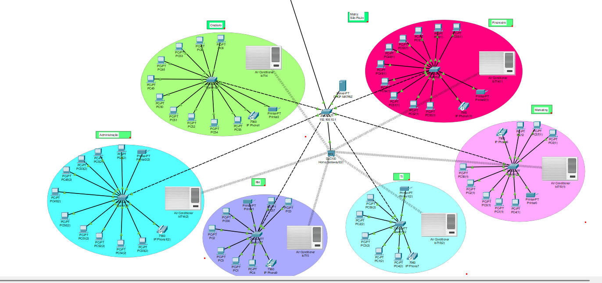
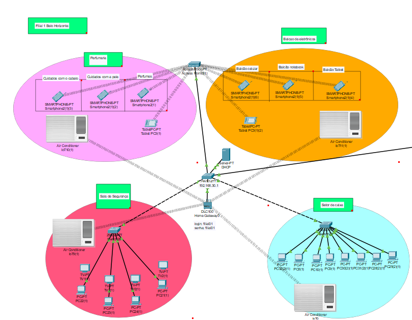
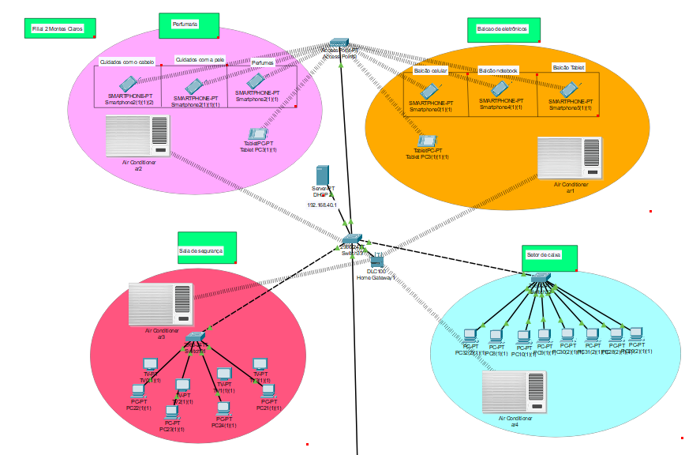
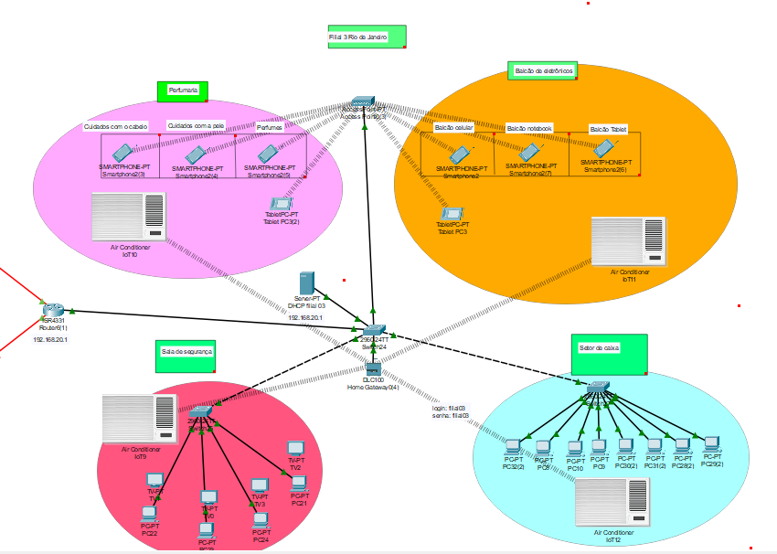
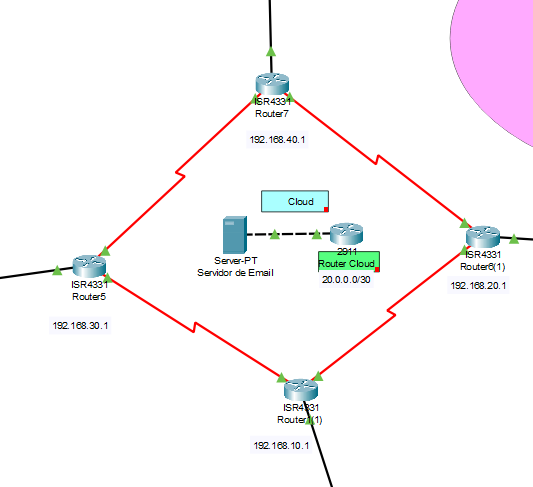

# Rede Corporativa — Cisco Packet Tracer

Projeto acadêmico de simulação de infraestrutura de redes, desenvolvido no Cisco Packet Tracer, utilizando como cenário uma empresa varejista fictícia com uma matriz e três filiais.

## Sobre o projeto

O objetivo foi estruturar uma rede corporativa capaz de conectar diferentes unidades e setores, permitindo a comunicação entre computadores, equipamentos de rede e serviços compartilhados.

O projeto envolveu planejamento de endereçamento IP, configuração de roteadores e switches, distribuição automática de endereços, roteamento dinâmico e integração de serviços de rede.

## Arquitetura da rede

A infraestrutura é composta por quatro unidades:

| Unidade | Rede local | Gateway |
|---|---|---|
| Matriz — São Paulo | 192.168.10.0/24 | 192.168.10.1 |
| Filial 01 — Belo Horizonte | 192.168.30.0/24 | 192.168.30.1 |
| Filial 02 — Montes Claros | 192.168.40.0/24 | 192.168.40.1 |
| Filial 03 — Rio de Janeiro | 192.168.20.0/24 | 192.168.20.1 |

A comunicação entre as unidades utiliza roteadores Cisco e o protocolo RIPv2.

## Tecnologias e serviços

- **Cisco Packet Tracer:** simulação da infraestrutura.
- **TCP/IP:** endereçamento e comunicação entre dispositivos.
- **RIPv2:** roteamento dinâmico entre unidades.
- **DHCP:** distribuição automática de configurações IP.
- **DNS:** resolução de nomes.
- **HTTP:** disponibilização de página web.
- **SMTP e POP3:** comunicação por e-mail.
- **Telefonia IP:** comunicação entre ramais.
- **Wi-Fi e IoT:** conectividade e controle de dispositivos inteligentes.

## Configurações e testes

Durante a revisão da infraestrutura, foram realizados ajustes nos endereços IP, pools DHCP, gateways, enlaces entre roteadores, configurações de roteamento e serviços.

Os testes registrados na documentação incluem:

- Comunicação entre matriz e filiais.
- Renovação de endereços por DHCP.
- Resolução de nomes por DNS.
- Acesso à página web compartilhada.
- Envio e recebimento de e-mails.
- Controle de dispositivos IoT.
- Registro de seis ramais IP e realização de chamada interna.
- Funcionamento demonstrativo de televisão por cabo.

## Como executar

1. Instale o Cisco Packet Tracer.
2. Baixe o arquivo `Projeto_A3_CORRIGIDO.pkt` deste repositório.
3. Abra o arquivo no Packet Tracer.
4. Aguarde a inicialização dos dispositivos e a estabilização dos enlaces.
5. Utilize os computadores das unidades para testar conectividade e serviços.

## Aprendizados

O desenvolvimento e a revisão deste projeto proporcionaram experiência prática com configuração e diagnóstico de redes, planejamento de endereçamento, roteamento, integração de serviços e resolução de problemas de conectividade.

## Contexto

Projeto desenvolvido em ambiente acadêmico, em grupo, com configurações e testes realizados em simulador. A empresa e os ambientes representados são fictícios.

---

## Topologia da rede

### Matriz — São Paulo

### Filial 01 — Belo Horizonte

### Filial 02 — Montes Claros

### Filial 03 — Rio de Janeiro

### Interligação dos roteadores — WAN

